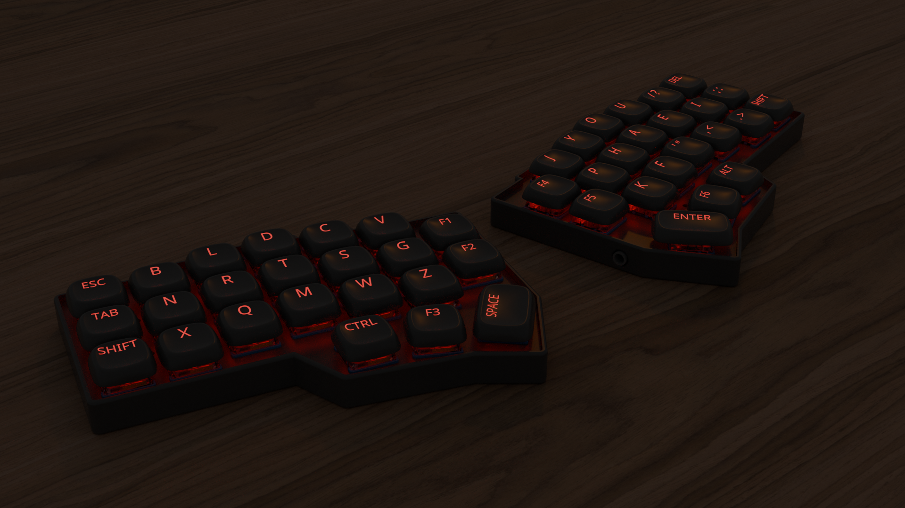
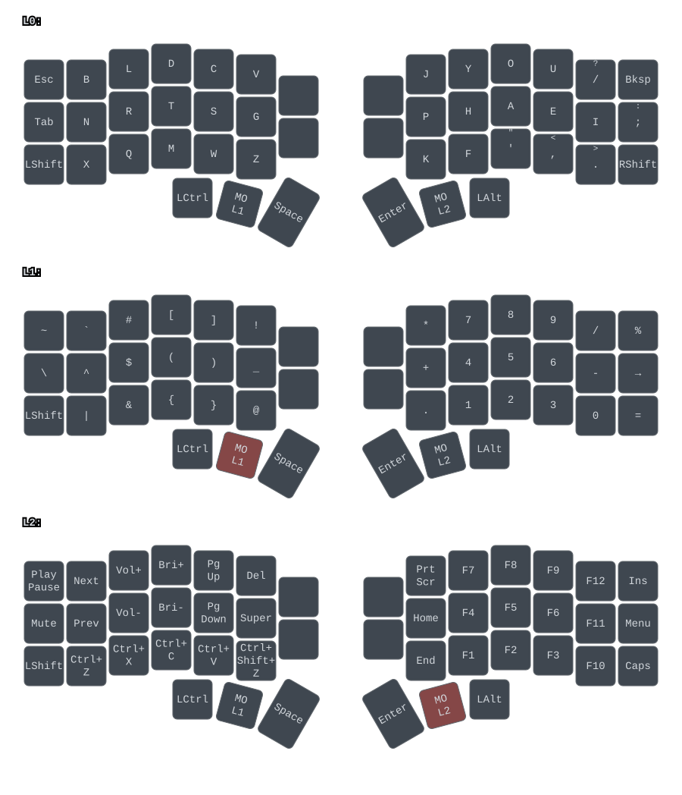

# glyph

A compact split keyboard built around the Corne v4.1, with a custom Gallium keymap, silent tactile switches, and shine-through keycaps.



## The Keyboard

The [Corne](https://github.com/foostan/crkbd) is a compact split keyboard. Its two halves can be positioned independently to suit your shoulders and wrists, while its small footprint leaves more room for a mouse.

This build uses the 46-key Corne v4.1. The keys follow a column-staggered arrangement, with each column offset to accommodate different finger lengths. Frequently used modifiers and layer keys sit under the thumbs.

## The Layout

[Gallium](https://github.com/GalileoBlues/Gallium) is an alternative to QWERTY designed to make typing more comfortable. It puts frequently used letters in accessible positions and reduces awkward finger movements, including consecutive presses with the same finger.

The letter positions are shown below, with punctuation omitted:

```text
QWERTY    q w e r t    y u i o p
          a s d f g    h j k l
          z x c v b    n m

Gallium   b l d c v    j y o u
          n r t s g    p h a e i
          x q m w z    k f
```

For an introduction to alternative layouts and their tradeoffs, see [A guide to alt keyboard layouts](https://getreuer.info/posts/keyboards/alt-layouts/index.html).

### Layers

Layers let the same physical keys perform different functions. Much like holding Shift changes a letter to uppercase, holding a layer key turns the main keys into numbers, symbols, navigation keys, or function keys.

This keymap uses L1 and L2 to access additional layers. I also adjusted some punctuation positions to suit my preferences.



The diagram is generated from [`keymap.yaml`](keymap.yaml) using [keymap-drawer](https://keymap-drawer.streamlit.app/).

## Sourcing Parts

- **Keyboard:** Barebones Corne v4.1, purchased preassembled from [Amazon](https://www.amazon.com/dp/B0F5WF64L5)
- **Switches:** Deep Sea silent tactile low-profile Kailh Choc v2 switches, purchased from [Amazon](https://www.amazon.com/dp/B0F8NLZQQD)
- **Keycaps:** Womier/XVX low-profile black shine-through keycaps, purchased from [Amazon](https://www.amazon.com/dp/B0BVYV67QS/)

I may eventually replace the keycaps with custom shine-through keycaps from [FK Custom](https://custom.fkcaps.com/custom/) to match the Gallium layout and my modifier keys.

## Firmware and Configuration

I flashed both halves with the standard Corne v4.1 Vial firmware from the [Corne firmware guide](https://github.com/foostan/crkbd/blob/main/docs/firmware/rev4/firmware_en.md), then configured the key assignments and layers using [Vial](https://vial.rocks/).

The configuration is saved in [`layout.vial`](layout.vial). To load it onto a compatible keyboard, connect the keyboard, open Vial, and choose **File → Load saved layout**.

## Modeling and Rendering

I assembled a model of the keyboard in [Onshape](https://cad.onshape.com/documents/324198341e9456afce69daac/w/e647adabd7fddf8fcf1ff7f7/e/acd9337fed6768df5d6f1b25?renderMode=0&uiState=6ad99cca157f8c0891dca90d), using the Corne PCB and plate designs alongside switch models and custom keycaps. The keycaps use configurable legends, with separate opaque shells and clear inserts for shine-through lettering.

I exported the assembly to [Blender](https://www.blender.org/) to add materials, lighting, and a desk environment, then rendered it using Cycles. The render shows the planned custom legends rather than the stock keycap lettering.
